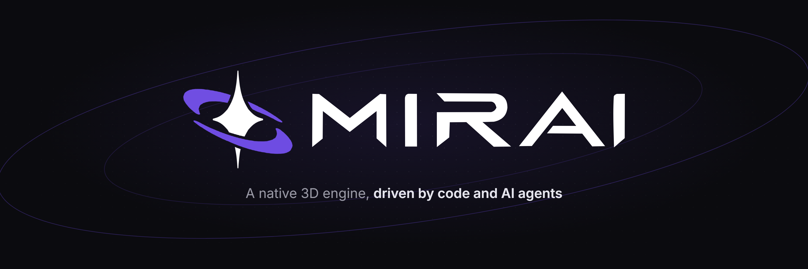
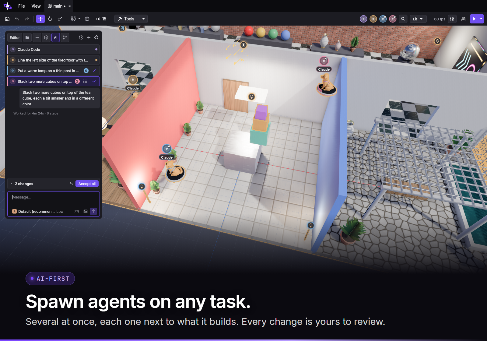
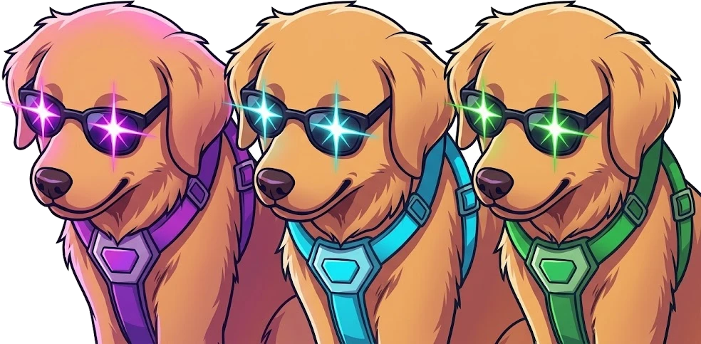
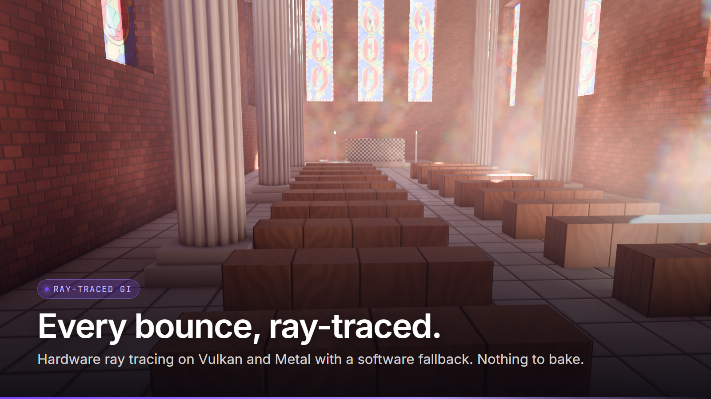
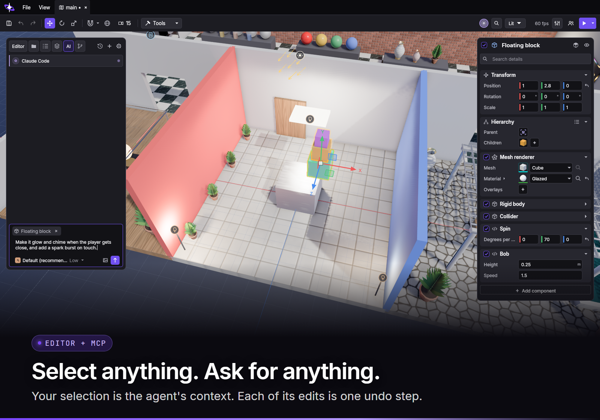

<p align="center">
  
</p>

<h3 align="center">The game engine for humans and agents.</h3>

<p align="center">
  AI-first · multiplayer by design · data-oriented · ray-traced
</p>

<p align="center">
  <a href="#quickstart">Quickstart</a> ·
  <a href="#why-mirai">Why Mirai</a> ·
  <a href="#documentation">Docs</a> ·
  <a href="#help-us-make-it-better">Contribute</a>
</p>

<p align="center">
  
  
  
  
  
</p>

---

Mirai is a native 3D engine and editor where people and AI agents build the same game, in the
same scene, at the same time. Connect your favorite agent inside the editor, or connect it externally via MCP or JSON-RPC. 
<p align="center">
  
</p>

## Why Mirai

### AI-first, not AI-added

- **Agents live in the editor.** Claude, Codex or any [ACP](https://agentclientprotocol.com)
  agent opens a chat next to the viewport. Several run at once, each one a figure next to what it
  is working on.
- **Everything is an API.** The editor serves JSON-RPC and MCP with the same methods a person
  uses: build scenes, edit materials, play, capture frames, etc.
- **You stay in control.** Each agent change is attributed and outlined in the scene. Accept it,
  revert it or retry it.
- **Errors that teach.** Invalid input never crashes the engine: it returns what failed and how to
  fix it, so an agent can correct itself.

### Humans and agents, together

<p align="center">
  
</p>

- **Multiplayer editing.** Share your session and your team can join with an
  invitation code. Everyone sees everyone in the scene:
  people and their agents.
- **Multiplayer games, first-party.** Authoritative server, client prediction, rollback, lag
  compensation, delta replication and dedicated servers, with networked Play inside the editor.

### Data-oriented to the core

- **A game is data and functions.** Components and storages are flat structs; loop functions
  declare in their signature exactly what they read and write.
- **ECS, not OOP.** No classes, no inheritance trees, no virtual `Update()` on every object

### Zero C++, fast to build

- **All in [Odin](https://odin-lang.org).** One fast compiler, readable code, no header soup and no multi-hour engine rebuilds.
- **Code reloads into the running editor.** Change your game, build, and keep editing the same
  scene.
- **One implementation of everything.** No per-platform or per-API copies: one renderer for Vulkan
  and Metal, one Slang source for every shader.

### Modern rendering

<p align="center">
  
</p>

- **Ray-traced global illumination** with hardware ray tracing on Vulkan and Metal and a software
  BVH fallback. Every bounce, in real time, with no baking.
- **Traced reflections and glass**, OpenPBR materials, physical light units, ACES 2.0 and HDR.
- **Cluster LOD and GPU culling** for dense scenes, streamed geometry and textures by distance.
- **Physical atmosphere** built in; **volumetric fog, water, particles, decals** and FSR frame
  generation as plugins.

### Batteries included, all optional

First-party plugins that add nothing to your game until you use them: physics, destruction,
ragdolls, motion-matching animation, AI minds with smart objects and navmesh, terrain, foliage,
water, VFX, portals, cinematics, world streaming and more.

<p align="center">
  
</p>

## Quickstart

On Windows, Linux or macOS ARM64, from the engine root in bash (Git Bash on Windows):

```sh
./mirai edit demo
```

That builds and opens the editor with the included [demo](demo). To play it instead:
`./mirai play demo`. To make games without building the engine, grab the package for your
platform from the [releases](https://github.com/mirai-engine/mirai/releases).

Building needs Odin `dev-2026-11` and the platform's graphics driver; `./mirai doctor` says what is
missing. Platform setup, templates and commands are in
[projects](.agents/skills/mirai-projects/references/projects.md#common-commands).

## Documentation

Mirai documents itself for humans and agents alike: each area has a skill in `.agents/skills/`
with a map from tasks to references.

| Area | Skill |
| --- | --- |
| Data core, generator, host | [mirai-core](.agents/skills/mirai-core/SKILL.md) |
| Editor | [mirai-editor](.agents/skills/mirai-editor/SKILL.md) |
| Agent API (JSON-RPC, MCP) | [mirai-agent-api](.agents/skills/mirai-agent-api/SKILL.md) |
| Rendering and RHI | [mirai-rendering](.agents/skills/mirai-rendering/SKILL.md) |
| Networking | [mirai-networking](.agents/skills/mirai-networking/SKILL.md) |
| Physics and destruction | [mirai-physics](.agents/skills/mirai-physics/SKILL.md) |
| Animation | [mirai-animation](.agents/skills/mirai-animation/SKILL.md) |
| Gameplay | [mirai-gameplay](.agents/skills/mirai-gameplay/SKILL.md) |
| Plugins | [mirai-plugins](.agents/skills/mirai-plugins/SKILL.md) |
| UI | [mirai-ui](.agents/skills/mirai-ui/SKILL.md) |
| Assets | [mirai-assets](.agents/skills/mirai-assets/SKILL.md) |
| Importing | [mirai-imports](.agents/skills/mirai-imports/SKILL.md) |
| Projects and build | [mirai-projects](.agents/skills/mirai-projects/SKILL.md) |
| Standard library | [mirai-std](.agents/skills/mirai-std/SKILL.md) |
| Platform and audio | [mirai-platform](.agents/skills/mirai-platform/SKILL.md) |

The layers and contracts are in [ARCHITECTURE.md](docs/ARCHITECTURE.md) and the project rules in
[AGENTS.md](AGENTS.md).

## Help us make it better

Mirai is young and moves fast, so yes, there are bugs. If something breaks, looks wrong or is
harder than it should be, [open an issue](https://github.com/mirai-engine/mirai/issues) with the steps
to reproduce it — or send a pull request. Bug reports, fixes, plugins and demo scenes are all
welcome, from humans and agents alike.

## License

Dual-licensed under [MIT](LICENSE-MIT) or [Apache-2.0](LICENSE-APACHE), at your choice.
Third-party material and its notices are in [THIRD_PARTY_NOTICES.md](THIRD_PARTY_NOTICES.md).
